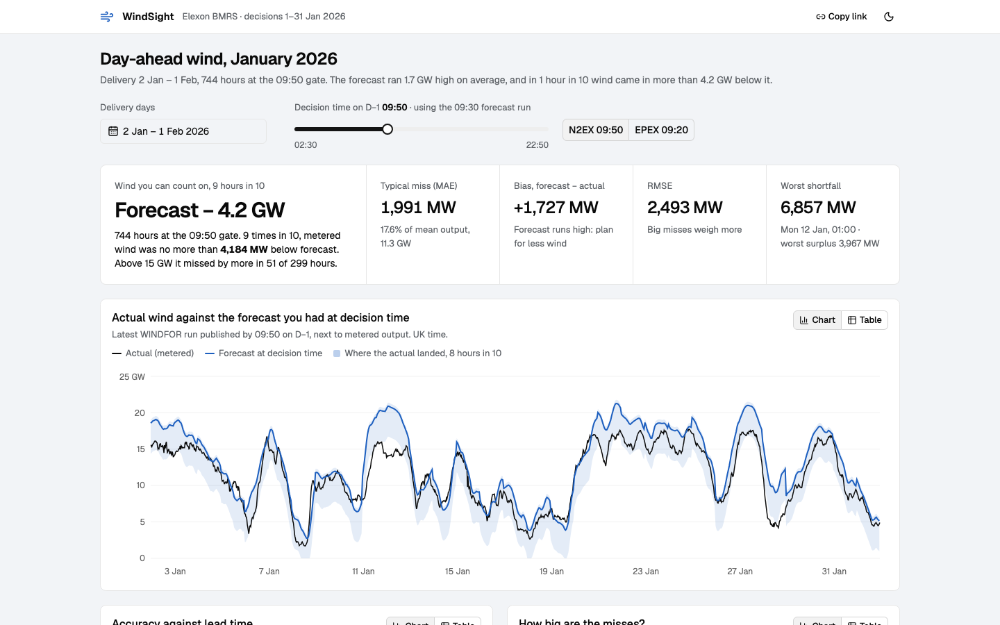

# WindSight

A small web app for a UK day-ahead power buying desk. It shows what the national wind forecast said at the moment the desk had to buy, puts it next to what the wind farms actually produced, and measures how wrong the forecast was. Data is Elexon BMRS only (FUELHH actuals, WINDFOR forecasts), for purchase decisions made in January 2026.

Live demo: https://fjkvdknkb.vercel.app



## How it works

The desk buys power for delivery day D in the day-ahead auction on D-1. N2EX closes at 09:50 UK time, EPEX at 09:20. So for every delivery hour the question is "which forecast run was the latest one published before that gate", and then "how far off was it". That rule is the whole backend, and everything on the page follows from it:

- The title line is the finding for whatever you have selected.
- The strip under it has the planning number (forecast minus the P90 error, so the wind you can count on 9 hours in 10), then MAE, bias, RMSE and the worst shortfall with its date.
- The big chart is actual against the forecast you had at decision time, with a band showing where the actual landed 8 hours in 10.
- The two smaller charts are accuracy against lead time and the error distribution.
- Every chart has a table view with plain numbers and ISO times, so you can paste into Excel.
- The URL carries the selection, and there is a Copy link button, so you can send someone the exact view.

You can change the delivery days and the decision time (02:30 to 22:50, with N2EX and EPEX presets). Dragging the time is the quickest way to see that waiting for a later forecast barely helps.

## Running it

With Docker:

```bash
docker compose up --build
```

then open http://localhost:8080. Two containers: `api` (FastAPI, Python 3.12) and `web` (nginx serving the React build and proxying `/api`). No keys, no env vars. The first request pulls about 2.5 MB from Elexon and takes a couple of seconds; after that it is served from memory.

Without Docker:

```bash
# backend
cd backend
uv venv --python 3.12 .venv
uv pip install -p .venv -r requirements-dev.txt
.venv/bin/uvicorn app.main:app --reload --port 8000

# frontend, in another terminal
cd frontend
npm install
npm run dev        # http://localhost:5173, proxies /api to :8000
```

API docs are at http://localhost:8000/api/docs.

## Tests

```bash
cd backend && .venv/bin/pytest -q && .venv/bin/ruff check . && .venv/bin/ruff format --check .
cd frontend && npm run check      # tsc, oxlint, prettier, vitest
cd frontend && npm run e2e        # Playwright; it starts the API and a preview server itself
```

44 backend tests (domain rules, API contract, and the Elexon client against a fake upstream, no network), 18 frontend unit tests, and 6 Playwright journeys that run on desktop and on a phone. Lighthouse against the Docker stack gives 0.78 performance, 1.00 accessibility and 1.00 best practices on the mobile profile.

## The API

```
GET /api/v1/wind/analysis?from=2026-01-02&to=2026-02-01&gate=09:50
```

`from` and `to` are delivery days between 2026-01-02 and 2026-02-01. `gate` is HH:MM UK time on D-1 and has to be before 23:00. The response has the half-hourly series (actual, forecast, publish time, lead time, error, band), the metrics, the lead-time profile and the histogram. Errors always look like `{"error": {"code", "message", "details"}}`. `GET /api/v1/health` is the health check.

## Deploying to Vercel

The repo is one Vercel project: the Vite build is served as static files and `api/index.py` runs the same FastAPI app as a Python function. `vercel.json` has the rewrite and the headers.

```bash
npx vercel login
npx vercel --prod
```

Nothing to configure, no environment variables.

## What is where

```
api/index.py              Vercel entrypoint, imports backend/app
backend/app/analysis.py   domain logic: delivery window, gate cutoff, picking the forecast, metrics
backend/app/elexon.py     Elexon client, validates the rows and keeps them in memory
backend/app/main.py       FastAPI routes, validation, error envelope, cache headers
backend/app/schemas.py    response models (camelCase JSON)
backend/tests/            pytest
frontend/src/App.tsx      page shell, title line, methodology card
frontend/src/components/  controls, summary strip, the three charts, chart card with its table twin
frontend/src/hooks/       data fetching, theme, media query
frontend/src/lib/         API types, URL parsing, formatting, tick maths
frontend/e2e/             Playwright tests
frontend/nginx.conf       static files, /api proxy, gzip, caching, security headers
docker-compose.yml        api + web
vercel.json               static build + python function + rewrites + headers
pyproject.toml, uv.lock   python deps; requirements.txt is exported from the lock for Docker
docs/                     pitch, design notes, screenshot
```

## Data

Actuals: Elexon FUELHH, fuelType WIND, half-hourly metered output of transmission-connected wind.
https://bmrs.elexon.co.uk/api-documentation/endpoint/datasets/FUELHH/stream

Forecasts: Elexon WINDFOR, hourly, published 8 times a day (02:30, 04:30, 07:30, 09:30, 11:30, 15:30, 18:30, 22:30 UTC), up to about 66 hours ahead.
https://bmrs.elexon.co.uk/api-documentation/endpoint/datasets/WINDFOR/stream

Gate times come from the Nord Pool GB day-ahead rules (09:50 UK, delivery day 23:00 to 23:00) and EPEX SPOT GB (10:20 CET, so 09:20 UK).

## AI tools

I used Claude Code (Anthropic) while building this. It helped with researching the datasets and the auction timings, scaffolding the project, a good share of the code and tests, and first drafts of these docs. I reviewed and ran everything myself, and every number in the docs comes from running the code against the live Elexon API.
