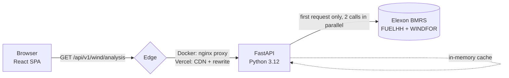

# Design notes

These are my notes for whoever reviews the code: how I read the brief, how the pieces fit, what I tested, and what I would change next.

## The question

The desk buys for delivery day D at the day-ahead gate on D-1 (N2EX 09:50 UK, EPEX 09:20). Nord Pool's GB rules define the delivery day as 23:00 D-1 to 23:00 D, UK time. "Decisions in January 2026" therefore means gates on 1 to 31 January and delivery days 2 January to 1 February, a target window of 1 Jan 23:00 to 1 Feb 23:00 UTC (UK time is UTC in January).

That gives one rule, and it is the whole product: for every target hour, find the gate of the auction that traded it, take the latest WINDFOR row published at or before that gate, and compare it with FUELHH WIND at the same `startTime`.

Things I checked in the data before trusting it:

- FUELHH is half-hourly, WINDFOR hourly. 1,536 and 19,856 rows for the window, no duplicates, and the stream endpoint does not cap rows.
- WINDFOR runs at 02:30, 04:30, 07:30, 09:30, 11:30, 15:30, 18:30 and 22:30 UTC and reach about 66 h ahead. Each run also restates a few hours already past. I drop those because they are not forecasts.
- One run in January was late (15 Jan, published 12:25 instead of 11:30). Because I select on `publishTime`, it is only used for gates from 12:25, which is what should happen.
- At the 09:50 gate the run in use is the 09:30 one, lead times 13.5 to 36.5 h.
- Comparing the hourly forecast against the :00 half-hour, the :30 half-hour, or the mean of both moves MAE by about 2%, so I kept the plain `startTime` match the brief asks for.

## Architecture

One read-only endpoint. The browser sends `from`, `to` and `gate`; the backend does all the domain work and returns something ready to plot, so the browser never sees raw Elexon data.

No database. The data is a fixed historical month of about 2.5 MB, so each process fetches both datasets once (two calls in parallel, about 2 s), validates them and keeps them in memory. A lock stops concurrent cold requests from fetching twice. A failed fetch raises and is not cached, so the next request retries. The same goes for an empty 200 or rows with the wrong fuel type. I added those two guards after noticing that an empty list would otherwise have been memoised for the life of the process and sent out with a 24 hour CDN header.

Successful responses carry `Cache-Control: public, max-age=3600, s-maxage=86400`. On Vercel the CDN answers repeat queries; in Docker the browser cache does. gzip takes the full month from 239 KB to about 26 KB.

## Backend

`analysis.py` is pure. Every function takes plain data and returns a value, which is why most of the tests live there. Forecasts are grouped by target hour and sorted by publish time, and `bisect_right` finds the latest run at or before the gate. `decision_cutoff` converts the target to Europe/London, picks the auction day (the same day from 23:00, otherwise the day before), combines it with the gate time and converts back to UTC. January never crosses the BST switch but there is a test for it anyway.

`elexon.py` is the only I/O. httpx with a 15 s read and 5 s connect timeout, which keeps a cold start inside Vercel's 30 s limit. Rows are validated with Pydantic: timestamps have to carry an offset, and FUELHH rows have to be WIND.

`main.py` is the HTTP layer. Input is validated before Elexon is touched, so bad input is a 422 even when upstream is down. Every error, including unexpected ones, comes back as `{"error": {"code", "message", "details"}}`. Upstream failures map to 502. The gate pattern is `^([01][0-9]|2[0-2]):[0-5][0-9]$` with explicit ASCII digits, because `\d` also matches digits from other scripts and `time.fromisoformat` then blows up with a plain-text 500.

`schemas.py` holds the response models with camelCase aliases; they also drive the OpenAPI docs.

Metrics, with error defined as forecast minus actual (positive means the buyer is short):

- MAE, also as a percentage of mean output
- RMSE, because big misses cost the most in imbalance
- bias, which turned out to be the main finding
- P10, P50 and P90 of the error. P90 drives the headline figure and the band is drawn from P10 to P90 around the forecast
- max shortfall and max surplus, with the hour of the worst shortfall shown in the UI
- MAE of every run against its lead time, 0 to 48 h
- a histogram of errors in 500 MW bins

Quantiles use `statistics.quantiles(method="inclusive")`. There is no pandas or numpy; the data is small and this keeps the Vercel function small and quick to start.

## Frontend

Vite, React 19, TypeScript strict, Tailwind v4, a few shadcn/ui primitives (popover and calendar, slider, toggle group, alert) and Recharts.

There is one piece of state, the query `{from, to, gate}`, mirrored into the URL so any view can be shared. `useAnalysis` fetches with an AbortController, so a superseded request is cancelled. While a new result loads the previous one stays on screen at reduced opacity. If a request fails I drop the stale result instead, because numbers sitting under controls they do not belong to are worse than an empty space with a Retry button. The slider commits on release, and keyboard steps are batched with a 250 ms delay, so holding an arrow key sends one request rather than thirty.

I wanted the screen to read like a tool the desk opens every morning rather than a dashboard template, so the chrome is ink and grey on a blue-grey ground, panels are white with a 1 px edge and no shadows, and the only hue is blue, reserved for the forecast line because that is the series the desk trades on. Actuals are drawn in ink and the surplus side of the histogram in grey. The headline numbers are one divided strip, 30 px for the answer and 24 px for the rest, with no icons or tinted tiles. There is one 24 px title with the finding in a sentence under it. Chart lines are straight segments, since a smoothed curve would invent values between half-hours. Legends sit in the card headers, units are on the top axis tick, and each chart has a table twin with plain numbers and ISO timestamps so a paste into Excel gives real numbers and dates.

Accessibility fixes I made after running axe and Lighthouse: the slider thumb now carries the accessible name and announces the time rather than a minute count; the date popover is a named dialog; chart sections are real h2 headings; table scrollers are named regions reachable from the keyboard; focus rings meet 3:1; `prefers-reduced-motion` turns animation off. Dark mode follows the OS until you toggle it, and a tiny blocking script in `public/theme.js` applies the class before first paint so there is no white flash.

Performance: Recharts and the calendar are separate chunks, so the first paint ships 128 KB of gzipped JS instead of 254 KB and the figures appear before the charts do. The three charts are memoised so a slider move only re-renders when data changes, and the HTML preloads the default API query in parallel with the JavaScript. Lighthouse against the Docker stack on the mobile profile: 0.78 performance, 1.00 accessibility, 1.00 best practices, largest contentful paint 2.7 s on simulated slow 4G and about 0.2 s on a desktop connection.

## Tests

Backend, 44 tests, none touch the network:

- domain rules: window, cutoff including BST, latest run before the gate, the gate boundary being inclusive, gaps, half-hour rows, the metric maths, the band and its zero clamp, zero mean output, one-sided errors, the 48 h horizon cap, the histogram
- API: camelCase contract, cache header on success and none on errors, seven invalid-input cases including a Unicode digit, range errors naming the right field, 422 before any upstream call, 404 and 500 in the envelope, 502 on upstream failure
- Elexon client against `httpx.MockTransport`: the exact query parameters, second load served from memory, failed fetch not cached, empty or wrong-fuel payloads rejected and not cached, naive timestamps rejected, five concurrent cold requests fetch once

Frontend: 18 vitest unit tests for URL parsing and gate snapping, tick maths and formatting, plus 6 Playwright journeys that run on desktop and on a phone profile: first load with no console errors, the date picker applying on the second click and cancelling on Escape, the keyboard slider batching requests, the table view, and no horizontal scroll.

Containers: `docker compose up`, then curl for the health checks, the SPA fallback, the `/api` proxy, gzip, the security headers, the CSP being on documents only, immutable hashed assets and an uncached `index.html`.

## Deployment

Docker is two images. `api` is `python:3.12-slim` running as a non-root user with a health check, installing from `requirements.txt`, which is exported from `uv.lock` so Docker and Vercel run the same versions. `web` is a Node build stage and then `nginx:alpine`. The nginx config does gzip level 6 with `Vary`, sends `index.html` with `no-cache` so a redeploy cannot leave a stale shell pointing at removed asset hashes, marks hashed assets immutable for a year, repeats the security headers in each location (nginx drops inherited `add_header` as soon as a block adds its own), puts a CSP on documents only (Swagger UI at `/api/docs` loads from a CDN), and re-resolves the `api` upstream every 10 s so a recreated container is found. Compose starts `web` once `api` is healthy and health-checks both.

Vercel is one project. `vercel.json` builds the frontend as static output, deploys `api/index.py` as a Python function, rewrites `/api/*` to it, excludes tests and docs from the bundle, and sets the same security headers, the CSP for non-API paths and the immutable cache rule for `/assets/*`. HTTPS and HSTS come from Vercel.

## Trade-offs and limits

- Fetch on first request and keep in memory. Fine for a fixed historical month. For live data this becomes a scheduled ingest into Postgres or Parquet.
- The P10/P90 band is in-sample and pooled across wind levels. The flat haircut is too cautious below 15 GW and too loose above 20 GW, where it fails about half the time. The UI says so next to the headline; a level-conditioned band is the obvious next step.
- Part of the bias is a basis difference, not forecast skill. WINDFOR restatements of hours already past still sit about 15% above FUELHH, so the two datasets do not measure quite the same thing. The buying decision is unchanged, but a proper skill study should remove that offset first. This is stated in the methodology card.
- The gate slider starts at 02:30. Before the 02:30 run only the D-2 22:30 run exists and it stops before the last delivery hour, so earlier gates would silently cover 713 of 744 hours. The strip reports "N of M hours" whenever they differ.
- Hourly forecast against the half-hour starting on the hour, as the brief describes. The alternatives move MAE by about 2%.
- Delivery day 23:00 to 23:00, matching N2EX. EPEX half-hourly products or a 00:00 settlement-day view would need a toggle.
- Scope is fixed to January 2026. Making the window a parameter needs an ingest job.
- No rate limiting in the app. It is read-only, cached at the CDN and the inputs are bounded. I would add it before exposing live data publicly.
- During an Elexon outage, waiting requests retry one after another, because a failed fetch is deliberately not cached. A short negative cache would fix that if outages turn out to be common.
- FUELHH is transmission-metered wind only. Embedded wind would need another source, which is outside the brief.

## What I would do next

1. A level-conditioned haircut: P90 by forecast band (under 5 GW, 5 to 15 GW, over 15 GW). Over 20 GW the January error averaged +4.7 GW against +0.2 GW under 5 GW.
2. A bias-corrected forecast. Subtracting the trailing 7-day mean error, using only errors known before each run was issued, cut MAE from 2,019 MW to 1,567 MW on 648 January hours in a strict out-of-sample test.
3. A live mode with a rolling D+1 view and alerts, which needs persistence.
4. A demand forecast input, to turn the wind number into MW to procure.
